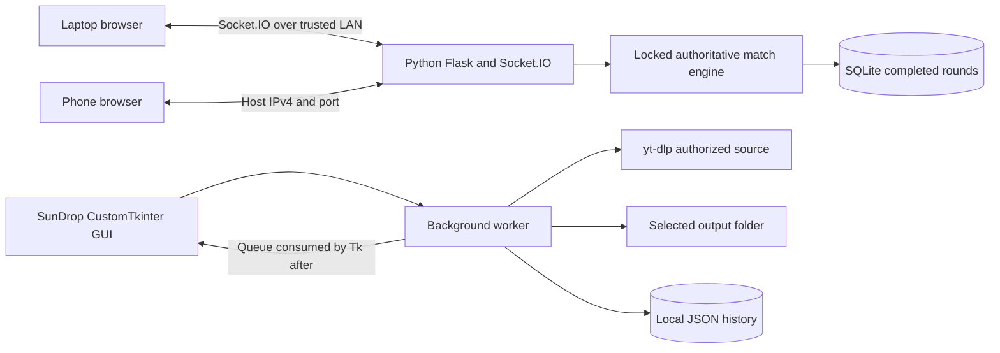

# Architecture and design

The phone in this diagram describes the intended deployment, not a verified physical-device test. The browser test used two tabs on the same laptop. An original SVG version is in `architecture.svg`.

MathDuel's `engine.py` owns rooms, identities, integer questions, scoring and phase transitions. `app.py` serializes Socket.IO actions and timer ticks under an RLock. The answer stays private during a question, and is published only during feedback/results. The client sends only answer, round number and match ID. It cannot set a score. A match ID changes on rematch so old packets cannot score again. Server monotonic time measures elapsed duration; client clocks only animate remaining time.

Lifecycle: lobby → question → feedback → next question → results. Ten questions, each up to 15 seconds, with two seconds of feedback. If everyone submits, feedback starts early. Missing players time out for zero points. Scores are `10 + floor(seconds_left / 3)`, clamped to a maximum five-point bonus; incorrect answers earn zero. A late answer is rejected at `now >= deadline` even if the background timer has not yet ticked.

Rooms use random six-digit codes checked against existing rooms, a two-player limit and a 30-minute absolute lifetime. A maximum 100 rooms and source-IP rate limits bound common abuse. Room creation and joining permit 15 events per minute per IP per action; other actions permit 120. Multiple players behind one IP share that budget. State is single-process memory, so multi-worker deployments are unsupported.

Solo uses the same game engine with one player. After five rounds, accuracy >=80% with average response <6 seconds raises difficulty; accuracy <50% or average response >12 seconds lowers it. The rules choose among easy, medium and hard. There is no model training or ML inference.

SQLite stores match ID, creation timestamp, mode, final scores and per-player round correctness, elapsed time and whether an answer was submitted. Parameterized queries and unique keys prevent duplicate completed records. Unanswered rounds count toward accuracy, but aggregate response time uses submitted answers only. Nicknames, URLs, IPs and resume tokens are not stored in SQLite. Old completed records are pruned after 30 days.

SunDrop validates HTTP(S) URLs without embedded credentials. Metadata supplies format IDs, title and an optional thumbnail. Unknown or protected sources fail with retryable messages. The service sanitizes Windows filenames and disables playlists. FFmpeg is optional; single-file original formats require no conversion. Downloads and metadata run in a daemon worker; the Tk main thread consumes a queue. Progress can be approximate when content length is unknown. Completion history is written atomically after yt-dlp returns, limited to 100 entries.

The retro update adds `artwork.py`: HTTP thumbnails are capped at 4 MB and 20 million pixels, decoded by Pillow, normalized to JPEG and cached under SHA256 filenames. Successful requests reuse the cache; failed requests get a separately cached original placeholder so a later preview can retry the source. The download keeps a sidecar image and records its path. MP3 tags are written by Mutagen to a temporary copy, reopened for title/artist/album/APIC and audio-duration verification, then atomically replace the original. A write failure leaves the original audio intact. Other audio and MP4 use sidecars only.

Explicit MP3 conversion is offered only if FFmpeg is present. The original source format remains selectable. `player.py` uses pygame-ce for local WAV/MP3/OGG playback and delegates unsupported types to the system file handler. Player progress uses elapsed playback time and known duration; missing duration shows an unknown total. Library records survive restarts, and moved files remain visible with disabled playback/open-file controls.

The room server is for a trusted local classroom network. It uses a development HTTP server with debug off, not public production hosting. Scores resist client packet tampering; this does not prevent external calculators or observation of another player's answer.
